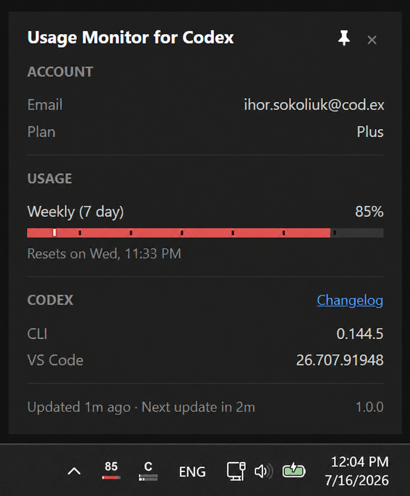

# Usage Monitor for Codex

**Monitor your Codex rate limits in real time - right from your Windows system tray.**

Usage Monitor for Codex is a lightweight, portable Windows tray app. It reads ChatGPT plan-usage windows from a local `codex app-server` child process and presents them using the notifications, popup, configurable bars, reset countdowns, and adaptive polling of the upstream Claude monitor.



## Features

- **Portable** - a single Windows EXE with no installer and no Python runtime required
- **Zero configuration for one account** - uses your existing Codex ChatGPT sign-in; the local app-server handles authentication and the monitor never reads a credential store
- **Live tray icon** - up to two configurable progress bars, with only available quotas drawn, plus a configurable tooltip, a percentage from the first displayed quota, automatic substitution when a configured window is absent, and theme-aware colors
- **Detail popup** - account email and plan plus every active usage window, including provider-named model limits and unusual durations; reset countdowns follow your Windows 12-hour or 24-hour clock setting
- **Codex versions** - reports the native CLI and `openai.chatgpt` extensions found in VS Code, Cursor, and Windsurf
- **Automatic Codex CLI updates** - runs the official self-updater at startup and daily by default, then notifies only when the installed version changes
- **Smart alerts** - configurable percentage thresholds, time-aware pace alerts, and reset notifications
- **[Event commands](docs/event-commands.md)** - opt-in shell commands on reset, threshold, startup, or tray double-click events
- **Time markers** - compare elapsed time with usage in the popup and tray; bars turn red when usage is ahead of pace
- **Automatic session recovery** - on an authentication error, asks the app-server to refresh once per continuous failure episode and observes a later sign-in without reading credential files
- **Adaptive polling** - speeds up while usage changes, pauses when Windows is idle or locked, aligns to resets, recycles persistent signed-out/auth-failure children, and refreshes healthy children on a bounded TTL
- **Multi-account** - one monitor per Codex home via `--codex-home`, with the credential-store requirement described below
- **13 languages** - English, German, French, Spanish, Portuguese, Italian, Japanese, Korean, Hindi, Indonesian, Simplified Chinese, Traditional Chinese, and Ukrainian
- **[Customizable](docs/configuration.md)** - polling, CLI updates, rotating logs, colors, alert thresholds, displayed fields, compact pinned mode, and event commands

## Security and transparency

The monitor is intentionally small and auditable:

- **No provider HTTP client** - the built-in monitor makes no outbound provider/API request. Account and usage data crosses local stdio to a spawned `codex app-server`; that external Codex process performs network activity and may update its own state according to your Codex configuration
- **Credentials never touched** - monitor code does not construct or inspect a credential-file/keyring location and never reads credential contents, existence, timestamps, or other metadata. Authentication state comes only from `account/read`
- **Provider boundary isolated** - JSONL transport is in [`app_server.py`](usage_monitor_for_claude/app_server.py) and response normalization/classification is in [`api.py`](usage_monitor_for_claude/api.py)
- **Sanitized rotating diagnostics** - raw provider responses remain in memory; each instance writes an independent rotating log beside the EXE without tokens, email addresses, credential data, or raw payloads
- **No hidden Python execution or obfuscation** - no `eval()`, `exec()`, `compile()`, dynamic imports, encoded endpoints, or minified application logic
- **Minimal runtime dependencies** - [Pillow](https://pypi.org/project/Pillow/), [pystray](https://pypi.org/project/pystray/), and [pywebview](https://pypi.org/project/pywebview/)

Three boundaries are deliberate: pywebview/WebView2 may use local loopback or runtime caches internally; the automatic updater invokes the installed `codex update`, which may use the network and replace Codex installation files; and enabling **Start with Windows** writes the monitor's value under the current user's Windows Run registry key. User-configured event commands run separately with the monitor's privileges and may read, write, launch programs, or use the network exactly as their command requests.

See [PRIVACY.md](PRIVACY.md) for the complete data-flow statement.

## Requirements

- Windows 10 or Windows 11, 64-bit
- A current [Codex CLI](https://github.com/openai/codex) installed as a native Windows command
- A ChatGPT-authenticated Codex session; run `codex login` and use the browser sign-in flow

The monitor displays ChatGPT plan usage. An API-key or Amazon Bedrock Codex authentication can be valid for Codex while still having no ChatGPT plan usage to display; the monitor reports that state explicitly. If `account/read` or `account/rateLimits/read` is unavailable, update the Codex CLI.

## Quick start

Download `UsageMonitorForCodex.exe` from the fork's [latest release](https://github.com/ihor-sokoliuk/usage-monitor-for-codex/releases/latest), place it in its own folder, and run it. If the tray shows `!`, run `codex login` with ChatGPT sign-in and let the next poll observe the session.

The default instance immediately creates `usage-monitor-for-codex.log` beside the EXE and rotates it automatically. Custom `--codex-home` instances add a stable, non-identifying hash suffix so simultaneous accounts never share a log file. To remove the app, first disable **Start with Windows** from its context menu, quit it, and delete the EXE, rotated logs, and any settings file you created.

## How to use

| Action | Result |
|---|---|
| Hover | Shows configured usage windows and reset times |
| Left-click | Opens the detail popup |
| Double-click | Runs `on_double_click_command` when configured; otherwise does nothing |
| Right-click | Opens popup, autostart, event-command tests, restart, project link, and quit actions |
| Escape or click outside | Closes an unpinned popup |

Windows may initially hide a new tray icon. In Windows taskbar settings, enable **UsageMonitorForCodex** under the system-tray icon list.

Each usage bar can show a fill percentage, elapsed-time marker, period dividers, and reset countdown. A duration-less window remains displayable, but has no time marker or dividers because its period is unknown.

## Run beside the Claude monitor

The Codex port has a separate executable name, mutex, process mapping, tray identity, autostart value, settings filename, and icon. The recommended layout is:

```text
C:\Tools\UsageMonitorForClaude\UsageMonitorForClaude.exe
C:\Tools\UsageMonitorForCodex\UsageMonitorForCodex.exe
```

Download the Claude executable only from the [upstream Claude monitor releases](https://github.com/jens-duttke/usage-monitor-for-claude/releases). Both monitors can run and start with Windows independently. Keep their settings files in their respective folders and smoke-test both after importing any upstream UI change.

## Configuration

Create `usage-monitor-for-codex-settings.json` with only the keys you want to override. The first existing file wins:

1. A custom Codex home selected by `--codex-home` or `CODEX_HOME`, when it differs from `~/.codex`
2. Next to the EXE, or the repository root when running from source
3. `~/.codex/usage-monitor-for-codex-settings.json`

The monitor never creates or modifies this file. See [Configuration](docs/configuration.md) for every active setting and field-naming behavior.

### Multiple Codex accounts

`--codex-home` isolates settings and child state, but it does not by itself guarantee account isolation when credentials live in a shared OS keyring. For each account:

1. Create a distinct Codex home.
2. Put `cli_auth_credentials_store = "file"` in that home's `config.toml` before login.
3. Run `codex login` with `CODEX_HOME` set to that directory and use ChatGPT sign-in.
4. Start one monitor with `--codex-home="<path>"`.

Keyring isolation, including `auto` when it resolves to keyring, is not verified for multi-account monitoring. See the complete [PowerShell walkthrough](docs/configuration.md#multiple-codex-accounts).

## Building from source

Build and test with native Windows Python from an NTFS clone. Do not run the build or Win32 tests from WSL or a `\\wsl.localhost` UNC path. Commands below assume the shell starts in the directory where you want the repository folder created.

Open PowerShell:

```powershell
git clone https://github.com/ihor-sokoliuk/usage-monitor-for-codex.git
Set-Location .\usage-monitor-for-codex
python -m venv .venv
.\.venv\Scripts\Activate.ps1
python -m pip install -r requirements.txt
python -m unittest discover -s tests
python -m usage_monitor_for_claude --verbose
python build.py
.\dist\UsageMonitorForCodex.exe --verbose
```

The internal package deliberately remains `usage_monitor_for_claude` so upstream UI improvements stay reviewable and mergeable. WSL-specific Codex CLI selection and building from the investigation clone are not supported in v1.

For popup-only HTML/CSS work, serve the repository root locally in one PowerShell window with `python -m http.server 8080`, then open `http://localhost:8080/usage_monitor_for_claude/popup/dev.html`. This local development server is separate from the packaged monitor's provider data path.

### Release checklist

Releases are built from tagged source by the Windows GitHub Actions workflow:

1. Update `__version__` and every version field in `version_info.py`.
2. Move the release notes from `[Unreleased]` into a dated version section in `CHANGELOG.md`.
3. Run the full suite, source smoke, clean build, frozen smoke, and dual-monitor smoke on Windows.
4. Commit and push the release preparation.
5. Create and push the matching namespaced tag, for example:

   ```powershell
   git tag -a codex-vX.Y.Z -m "Usage Monitor for Codex X.Y.Z"
   git push origin codex-vX.Y.Z
   ```

The tag workflow verifies the version, runs the Windows test suite, builds `UsageMonitorForCodex.exe`, writes a SHA-256 checksum, and publishes both files as the latest GitHub Release. Code signing is not configured; public binaries may therefore trigger a Windows SmartScreen warning.

## Contributing and upstream updates

Repository-wide agent and contributor rules live in [`AGENTS.md`](AGENTS.md). Run `python -m unittest discover -s tests` before handing changes off. Agents must not commit, push, tag, or use destructive Git operations; the user performs repository history operations.

This fork intentionally imports upstream UI/UX work selectively instead of syncing the entire Claude provider implementation. Follow [`UPSTREAM_SYNC.md`](UPSTREAM_SYNC.md); never use GitHub's one-click **Sync fork** for this repository.

## Credits

Forked from Jens Duttke's [Usage Monitor for Claude](https://github.com/jens-duttke/usage-monitor-for-claude). The original design, Windows tray UI, popup, notifications, polling behavior, localization framework, and much of the implementation come from that MIT-licensed project.

## License

MIT - see [LICENSE](LICENSE).

## Disclaimer

This is an independent, community-built project. It is not created, endorsed, or officially supported by OpenAI. "Codex", "ChatGPT", and "OpenAI" are used descriptively to indicate compatibility and are trademarks of OpenAI.

Refresh usage from the popup button or tray menu without waiting for the next poll. Active rate-limit backoff is still respected.
